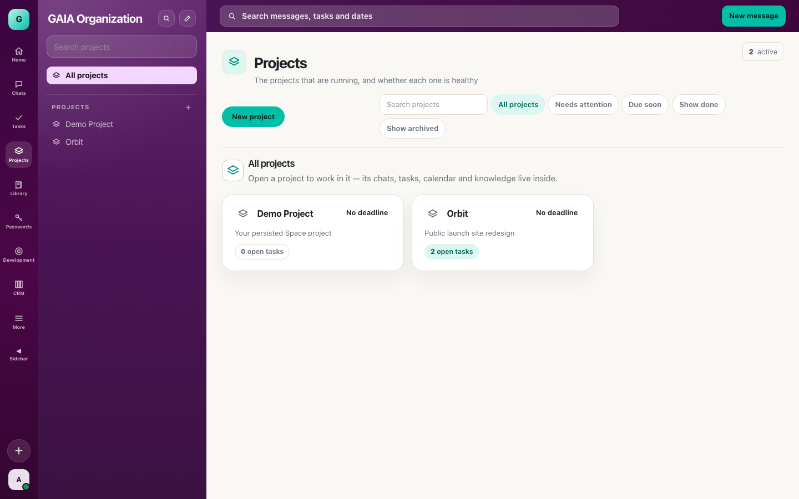
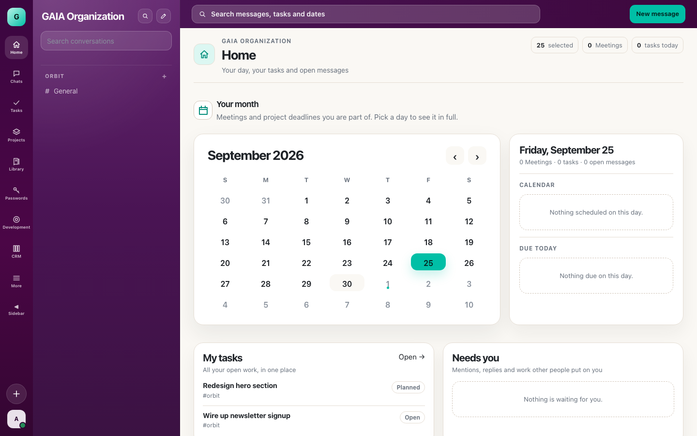
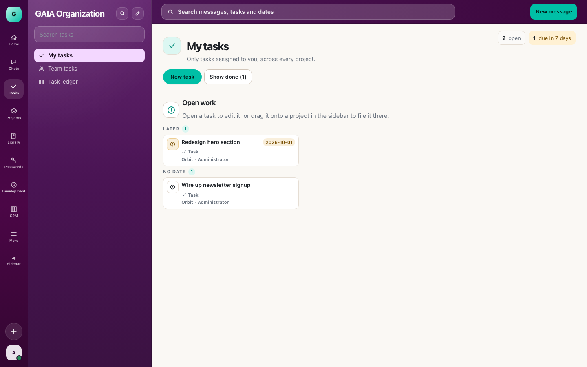
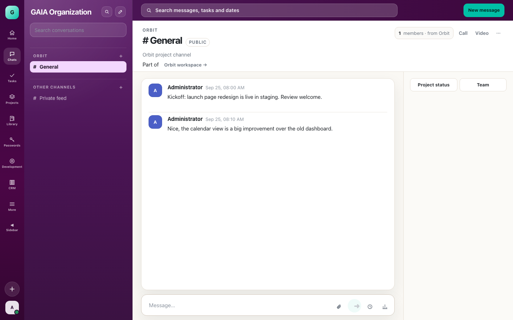

# GAIA Space

GAIA Space is a spiritual successor to JetBrains Space — the all-in-one dev/team platform (chat, tasks, projects, git & code review, CI/CD, docs, calendars, meetings) that JetBrains shut down in June 2025. GAIA Space is a from-scratch, open-source rebuild of that idea: one native app instead of a pile of disconnected SaaS tools, with your own server as the source of truth.

Built with [Tauri](https://tauri.app/) + [Solid](https://www.solidjs.com/) + TypeScript on the frontend and a [Rust](https://www.rust-lang.org/)/[axum](https://github.com/tokio-rs/axum)/SQLite backend (`space-server`), so it runs as a native desktop app or as a plain web app served behind your own domain.

## Screenshots

| | |
|---|---|
|  |  |
|  |  |

*(demo data — not a live/production instance)*

## What's in it

- **Chat** — channels, threads, mentions, pinning, drafts/typing, scheduled messages, polls, link unfurling
- **Tasks & Projects** — personal/team task lists, project workspaces, calendars, deadlines
- **Git & Code Review** — repo hosting, merge requests, diff review, CODEOWNERS, quality gates, stacked reviews
- **CI/CD & Packages** — pipelines, build workers, artifacts, a typed package registry
- **Documents & Meetings** — a knowledge base with rich documents, budgets/sheets, scheduled meetings and video calls
- **Directory & Auth** — profiles, teams, roles/rights, OAuth apps, SSO
- **Passwords vault** — a Vaultwarden-backed, same-origin password manager
- **HTTP API** — OAuth-scoped application tokens for third-party integrations

Feature parity against JetBrains Space is tracked in [`PARITY.md`](PARITY.md) (audited per domain, work ongoing — not everything is done).

## AI coding agent (in progress)

A native agent runtime is being built into the Rust backend (`src-tauri/src/agent/`), so a task can run against a project's bound repository, be reviewed through the existing review UI, and be committed under its own identity. It is staged and not yet user-facing; the plan, the security constraints and the per-stage gates live in [`roadmap.md`](roadmap.md).

What exists today: the V150 tables (provider keys, sessions, transcript, tool-call approvals), provider-key storage sealed with `secretbox` — keys are encrypted at rest and never travel back to the frontend in plaintext — an OpenAI-compatible chat-completions client behind an injected transport, so tests script every reply and never touch the network, and the read-only loop: a session's transcript is stored in SQLite (and replayed from it), three tools — `read_file`, `list_files`, `grep` — operate only inside the project's bound repository, and every run ends at a final answer, the step budget or cancellation. `write_file` and `edit_file` exist behind an approval gate: a turn containing a write is proposed whole and the run stops at `awaiting_approval`, the write runs only from a row the user approved, and a denial comes back to the model as a result. The containment rule is component-wise, so `..`, absolute paths, symlinks out of the tree and `.git` are refused before a tool touches anything — an approval is never a way around it.

## Getting started

```bash
bun install

# Desktop app (Tauri, no login required)
bun run tauri dev

# Backend API (SQLite-backed), separately
cd src-tauri && SPACE_DB=./space.db cargo run --bin space-server

# Or the web build, served behind /space/ and proxied to the backend
SPACE_SERVER_URL=http://127.0.0.1:8090 bun run dev -- --mode web
```

Checks: `bun run check` (typecheck), `bun test`, `cd src-tauri && cargo test`.

## License

MIT — see [LICENSE](LICENSE).
